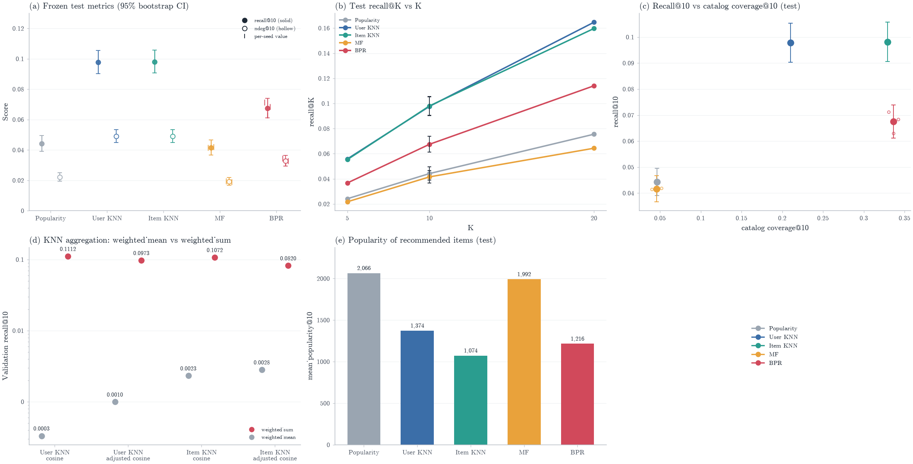

# Collaborative Filtering Recommender

> A reproducible MovieLens 1M benchmark for collaborative-filtering recommendation methods.

[](https://github.com/Creator101-commits/collaborative-filtering-recommender/actions/workflows/ci.yml)
[](./LICENSE)

This project provides a leakage-controlled top-N MovieLens 1M benchmark for popularity, user- and item-based KNN, biased matrix factorization, and Bayesian Personalized Ranking. Validation selection, frozen test evaluation, bootstrap analysis, and machine-readable comparison tables are implemented; Matplotlib reporting is available. See [`PLAN.md`](./PLAN.md) for the phased research and implementation plan.

## Table of Contents

- [Collaborative Filtering Recommender](#collaborative-filtering-recommender)
- [Quickstart / Demo](#quickstart--demo)
- [Installation](#installation)
- [Usage](#usage)
- [Development](#development)
- [Contributing](#contributing)
- [Release History](#release-history)
- [License](#license)
- [Meta](#meta)

## Quickstart / Demo
[(Back to top)](#table-of-contents)
Download, validate, prepare, and evaluate MovieLens 1M with the reproducible workflow:

```sh
uv sync
uv run recommender download
uv run recommender prepare
uv run recommender evaluate
# After creating experiment-card.json from validation results:
uv run recommender compare --experiment-card experiment-card.json
uv run recommender report
```

## Installation
[(Back to top)](#table-of-contents)

Requirements:

- macOS or Linux
- Python 3.12
- [uv](https://docs.astral.sh/uv/getting-started/installation/)

```sh
git clone https://github.com/Creator101-commits/collaborative-filtering-recommender.git
cd collaborative-filtering-recommender
uv sync --locked
```

## Usage
[(Back to top)](#table-of-contents)

```sh
uv run recommender download
uv run recommender prepare
uv run recommender evaluate
uv run recommender compare --experiment-card experiment-card.json
uv run recommender report
```

The `download` command fetches from GroupLens, verifies the pinned archive size and checksums, validates every source record, and writes `data/raw/movielens-1m/manifest.json`. Rerunning it reuses the data only when every file still matches the manifest. Use `--output-dir` to choose another location.

The `prepare` command reads the validated raw manifest, assigns stable zero-based indices in ascending identifier order, treats ratings `>= 4` as positive, and requires at least 3 positive interactions per evaluated user. It writes typed `ratings.parquet`, `movies.parquet`, `users.parquet`, `train.parquet`, `validation.parquet`, and `test.parquet` files plus `data/processed/movielens-1m/manifest.json`. Positive interactions are ordered by timestamp, movie ID, and source row; the last two become validation and test. `train.parquet` contains every source interaction earlier than validation, including lower-rated observations, while later unselected interactions remain outside training. Re-running with the same raw manifest and configuration reuses identical output and rejects stale or modified artifacts.

Use `--raw-dir`, `--output-dir`, `--positive-rating-threshold`, or `--minimum-positive-history` to override the defaults.
MovieLens 1M is provided by GroupLens for research use under conditions that require attribution and restrict redistribution and commercial use. Review the [dataset README and license](https://files.grouplens.org/datasets/movielens/ml-1m-README.txt) before use. Publications should cite F. Maxwell Harper and Joseph A. Konstan, “The MovieLens Datasets: History and Context,” ACM TiiS 5(4), 2015, https://doi.org/10.1145/2827872.

The `evaluate` command fits a selected model using only `train.parquet`, ranks the complete eligible catalog, evaluates against `validation.parquet`, writes a CSV result table and model artifact under `artifacts/`, and logs the run to local MLflow under `mlruns/`. It never reads `test.parquet`; test evaluation remains reserved for the frozen final protocol.

Use `--model popularity`, `--model user_knn`, `--model item_knn`, `--model matrix_factorization`, or `--model bpr`. KNN compares the `cosine` and `adjusted_cosine` similarity settings against `weighted_mean` (default) and `weighted_sum` score aggregation via `--aggregation`, with `--n-neighbors`, `--shrinkage`, and `--min-support` controlling the bounded configuration.

Matrix factorization uses seeded mini-batch squared-error training and validation-loss checkpoint selection. BPR uses seeded negative sampling, pairwise ranking loss, and validation-loss checkpoint selection. Configure either learned model with `--latent-dim`, `--learning-rate`, `--regularization`, `--epochs`, and `--batch-size`; BPR also accepts `--negative-samples`.

For example: `uv run recommender evaluate --model matrix_factorization --epochs 20` or `uv run recommender evaluate --model bpr --negative-samples 1`. Each validation run writes a CSV result table and a model artifact (`.json` for popularity/KNN, `.pt` for learned models) under `artifacts/`, and stores its MLflow run under `mlruns/`; both directories are ignored by Git.

The `compare` command runs the frozen final test evaluation and writes aggregate, bootstrap, paired-difference, and slice CSV tables. The `report` command consumes those tables without retraining and writes `artifacts/report/report.md`, `summary.csv`, and a Matplotlib PNG figure.

`EXPERIMENT_CARD.md` freezes the Phase 8 comparison protocol before final test evaluation. The pre-test audit and immutable JSON card helpers are available from `recommender.experiments`; the `compare` command applies the card without retraining or reselecting models.

## Development
[(Back to top)](#table-of-contents)

Run the same checks used by CI:

```sh
uv sync --locked
uv run pytest
uv run ruff check .
uv run mypy src
```

## Contributing
[(Back to top)](#table-of-contents)

1. Fork the repository.
2. Create a focused feature branch.
3. Add tests for the change.
4. Run all development checks.
5. Open a pull request with a clear description of why the change is needed.

Use conventional commit messages such as `feat:`, `fix:`, and `chore:`.

## Release History
[(Back to top)](#table-of-contents)

No releases have been published yet.

## License
[(Back to top)](#table-of-contents)

Distributed under the MIT License. See [`LICENSE`](./LICENSE) for details.

## Meta
[(Back to top)](#table-of-contents)

Sreeharsha Kannegundla

Project: [github.com/Creator101-commits/collaborative-filtering-recommender](https://github.com/Creator101-commits/collaborative-filtering-recommender)

## Results

Curated benchmark outputs are stored under [`results/`](./results/) and are copied unedited from the Kaggle run (`git_sha` `045f514a9df574d236a230fd1f00053d351a777a`, `protocol_version` `phase-8-v3`). The run writes `manifest.json`, `experiment-card.json`, `validation-results.csv`, `final-results.csv`, `final-slices.csv`, `paired-results.csv`, `report.md`, and supporting report assets. Every number reported in the README traces to a file in `results/`.

Frozen test metrics on MovieLens 1M (recall@10 with 95% bootstrap CI; ndcg@10 in parentheses):

| model | seeds | recall@10 [CI] | ndcg@10 | mean_popularity@10 | catalog_coverage@10 |
| --- | ---: | --- | --- | ---: | ---: |
| popularity | 1 | 0.0442 [0.0391, 0.0495] | 0.0222 | 2065.7 | 0.046 |
| user_knn | 1 | 0.0978 [0.0903, 0.1054] | 0.0491 | 1373.6 | 0.210 |
| item_knn | 1 | 0.0981 [0.0906, 0.1057] | 0.0491 | 1073.5 | 0.329 |
| matrix_factorization | 3 | 0.0414-0.0419 | 0.0191-0.0194 | ~1992 | 0.046 |
| bpr | 3 | 0.0630-0.0713 | 0.0313-0.0345 | ~1216 | ~0.336 |

Validation selection chose `cosine` similarity with `weighted_sum` aggregation for both KNN families (`n_neighbors=40`, `shrinkage=10`, `min_support=1`). The full 4-config KNN validation grid is in `results/validation-results.csv`.

## Findings

- **KNN with `weighted_sum` leads the frozen test.** user_knn recall@10 is 0.0978 [0.0903, 0.1054] and item_knn is 0.0981 [0.0906, 0.1057]; their intervals overlap almost completely and the paired recall@10 difference (user_knn minus item_knn) is -0.0003 [-0.0081, +0.0075], so the two KNN variants are statistically tied for first place. Both roughly double popularity's 0.0442.
- **BPR is the strongest learned latent model.** recall@10 is 0.0630-0.0713 across seeds 0-2 (mean 0.0676), clearly above popularity but below both KNN variants.
- **Matrix factorization collapses to popularity-level accuracy.** recall@10 is 0.0414-0.0419 across seeds, no better than popularity's 0.0442, and its mean_popularity@10 is about 1992 versus 2066 for popularity itself, with catalog_coverage@10 of only 0.046: the biased MF trained on raw ratings learned to recommend the popular head.
- **`weighted_mean` aggregation was orders of magnitude worse on validation.** Across the 8 KNN validation cells, weighted_mean recall@10 ranges 0.0003-0.0028 while weighted_sum ranges 0.0820-0.1112 (per-cell ratios about 29x to 371x); dividing by the summed absolute similarity of contributing neighbors turns the score into a predicted rating, so an obscure item reached through a single similar neighbor scores that neighbor's full rating and floods the top-N with long-tail items (weighted_mean mean_popularity@10 is 149-244 versus 1071-1591 for weighted_sum). This validation-only evidence motivated the phase-8-v3 correction (disclosed in `EXPERIMENT_CARD.md` and `REVIEW.md`).
- **KNN and BPR recommend a more diverse catalog slice.** catalog_coverage@10 is 0.21-0.33 for the KNN/BPR family versus 0.046 for popularity and MF, while mean_popularity@10 is lower (1074-1374 for KNN, ~1216 for BPR) than popularity's 2066.
- **Popularity is a strong baseline but not the ceiling.** It reaches recall@10 0.0442 [0.0391, 0.0495]; every other model family except MF beats it, and KNN roughly doubles it.

## Interpretation limits

The frozen test read happened once under `phase-8-v3`; earlier protocol versions are disclosed in `EXPERIMENT_CARD.md` and `REVIEW.md` (phase-8-v2 ran once to completion before the KNN aggregation defect was found; its test read was not used for selection). The reported leading model is descriptive from test scores, so paired intervals against it are exploratory and unadjusted for selection. KNN and popularity evaluate a single seed; MF and BPR use three declared seeds. Per-user chronology does not impose a single global time cutoff across all users.

## Reproducing the figure

`image.png` is rendered from `results/` by `scripts/render_figure.py` using `scripts/figure-data.json`. Run it in a Python environment containing the project dependencies and Matplotlib (for example `uv run --with matplotlib python scripts/render_figure.py`). Panels show frozen-test recall@10 and ndcg@10 with bootstrap intervals per model, the validation KNN aggregation comparison, and the test popularity-bias profile. The plotting environment is separate from the core runtime when Matplotlib is absent.
