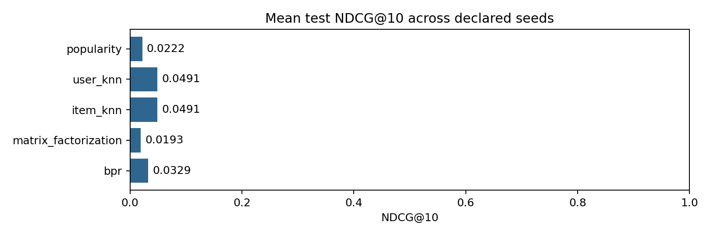

# Final comparison report

This report is generated only from the frozen final CSV artifacts. It does not retrain models or change their configurations.

## Primary results

| Model | Mean NDCG@10 | Declared seeds |
|---|---:|---:|
| popularity | 0.0222 | 1 |
| user_knn | 0.0491 | 1 |
| item_knn | 0.0491 | 1 |
| matrix_factorization | 0.0193 | 3 |
| bpr | 0.0329 | 3 |

The figure shows descriptive mean NDCG@10 across the declared learned-model seeds; it is not a new model-selection step.

## Paired differences

- `user_knn` minus `popularity` (recall@10): 0.05352112676056338 [0.046064623032311514, 0.06097763048881524]
- `user_knn` minus `popularity` (ndcg@10): 0.026907761215306233 [0.02285535246297337, 0.031052605846737646]
- `user_knn` minus `popularity` (mrr@10): 0.018889414920897938 [0.015325929432805986, 0.02254081350850199]
- `user_knn` minus `popularity` (hit_rate@10): 0.05352112676056338 [0.046064623032311514, 0.06097763048881524]
- `user_knn` minus `item_knn` (recall@10): -0.00033140016570008286 [-0.00811930405965203, 0.007456503728251864]
- `user_knn` minus `item_knn` (ndcg@10): 1.9614168345059903e-05 [-0.0038894082639411164, 0.0040193470436697435]
- `user_knn` minus `item_knn` (mrr@10): 6.667455714680225e-05 [-0.003361165358162044, 0.003581280164648014]
- `user_knn` minus `item_knn` (hit_rate@10): -0.00033140016570008286 [-0.00811930405965203, 0.007456503728251864]
- `user_knn` minus `matrix_factorization` (recall@10): 0.05617232808616404 [0.04871582435791218, 0.06363021264843964]
- `user_knn` minus `matrix_factorization` (ndcg@10): 0.029799164500705633 [0.02577393631919225, 0.033909791072203946]
- `user_knn` minus `matrix_factorization` (mrr@10): 0.021886460374447116 [0.018387636823117354, 0.025451072447758447]
- `user_knn` minus `matrix_factorization` (hit_rate@10): 0.05617232808616404 [0.04871582435791218, 0.06363021264843964]
- `user_knn` minus `bpr` (recall@10): 0.03021264843965756 [0.023584645125655904, 0.0367854183927092]
- `user_knn` minus `bpr` (ndcg@10): 0.016181183138512637 [0.012707887493031002, 0.019744521527317524]
- `user_knn` minus `bpr` (mrr@10): 0.011914055136921748 [0.008865316627433447, 0.01507049157691245]
- `user_knn` minus `bpr` (hit_rate@10): 0.03021264843965756 [0.023584645125655904, 0.0367854183927092]

## Slice coverage

The final slice table contains 162 rows across the locked slice definitions.

## Limitations

Bootstrap intervals resample users and do not model every dependency caused by shared items. The leading model is chosen descriptively from these test scores, so paired intervals against it are exploratory and do not adjust for selection. Results should be interpreted with the recorded configuration, manifest hash, run IDs, and Git revision.
